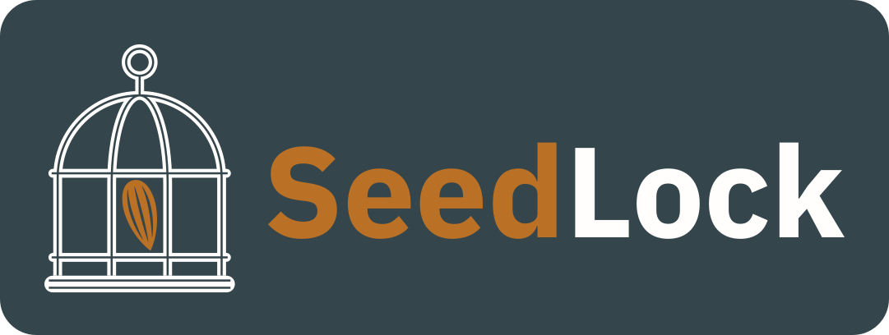

<h1 align="center"></h1>

**SeedLock keeps your Bitcoin seed on a computer that is never connected to the internet, and signs your payments
there.** It needs no special hardware: an ordinary laptop or desktop computer that you keep offline is enough. On
your everyday computer you use [Sparrow Wallet](https://sparrowwallet.com) to see your balance and prepare payments,
without your seed.

With SeedLock you can:

* create a seed, optionally from your own dice rolls, and save it as a **backup file encrypted with a password**,
  safe to keep on a USB stick or in the cloud;
* set up a watch-only wallet in Sparrow;
* **check and sign payments** that Sparrow prepares, brought over as a file on a USB stick or scanned from Sparrow's
  QR code with the computer's camera;
* be one of the keys of a **multisig wallet** (for example 2 of 3).

> **Status: version 0.3.0, not independently audited.** Nobody outside this project has reviewed it yet. Try it on
> testnet, or with a small amount, first. Never type a real seed into a website, a chat or an online computer.

## Contents

1. [Two computers: what each one is for](#two-computers-what-each-one-is-for)
2. [Part 1: get the SeedLock program, on the online computer](#part-1-get-the-seedlock-program-on-the-online-computer)
3. [Part 2: put SeedLock on the offline computer](#part-2-put-seedlock-on-the-offline-computer)
4. [Part 3: start SeedLock on the offline computer](#part-3-start-seedlock-on-the-offline-computer)
5. [First steps](#first-steps)
6. [If something goes wrong](#if-something-goes-wrong)
7. [More documentation](#more-documentation)
8. [License](#license)

## Two computers: what each one is for

|  | Online computer (your everyday computer) | Offline computer (never connected to the internet) |
|---|---|---|
| Its job | Sparrow Wallet shows your balance and prepares payments. It is a watch-only wallet: it has no seed. | SeedLock keeps your seed and signs payments. |
| Rust, to build SeedLock | Only if you build it yourself (Part 1, Way B), once | No |
| SeedLock | Only to download or build it. Never type a real seed here. | Yes: just the program file |
| Your seed (the words) | **Never** | Yes |
| Your encrypted backup files | Only copies to store, for example in the cloud | Yes |
| ffmpeg, for the camera and the QR window | No | Optional, installed before it goes offline |

**The offline computer needs only one file: the SeedLock program.** You download it ready-made, or build it yourself
on the online computer; Rust, `cargo` and SeedLock's source code are needed only to build it. The program runs on its
own.

A payment goes like this:

1. **Online:** Sparrow prepares the payment and saves it as a file on a USB stick, or shows it as a QR code.
2. **Offline:** SeedLock reads it (from the file, or with the camera), shows you every address and amount, and signs
   it only if you say yes.
3. **Online:** Sparrow reads the signed payment back (from the file, or by scanning SeedLock's QR code with its
   camera) and sends it to the Bitcoin network.

## Part 1: get the SeedLock program, on the online computer

The offline computer needs one program file. There are two ways to get it:

* **Way A: download it** ready-made, from SeedLock's GitHub page. The easiest way: a few minutes.
* **Way B: build it yourself** from SeedLock's source code, with the free Rust tools: about half an hour the first
  time. Then your own computer makes the program, from source code that anyone can read.

### Way A: download the ready-made program

1. On SeedLock's GitHub page (the page that shows this text), click **Releases** on the right. Under the newest
   release, in its **Assets**, download **SHA256SUMS.txt** and the program for your **offline** computer:

   | Offline computer | Program to download |
   |---|---|
   | Windows (64-bit) | `seedlock-0.3.0-windows-x86_64.exe` |
   | Mac, with an Apple chip or an Intel chip | `seedlock-0.3.0-macos` |
   | Linux, on a 64-bit Intel or AMD processor | `seedlock-0.3.0-linux-x86_64` |

   For other computers, such as a Raspberry Pi, build SeedLock yourself (Way B), and also if the newest release has
   no programs to download yet. If your browser warns that the program is not commonly downloaded, choose to keep it
   (in Edge: **...**, **Keep**, **Show more**, **Keep anyway**): the next step checks it.
2. **Check the download.** Open a terminal in the folder it was downloaded to (usually **Downloads**):
   * Windows: open the folder in File Explorer, click the address bar at the top, type `powershell` and press Enter.
   * Mac: open Terminal, type `cd ~/Downloads` and press Enter.
   * Linux: open a terminal, type `cd ` (with a space after it), drag the folder from your file manager onto the
     terminal window, and press Enter.

   Then type the line for your program and press Enter:

   | Program | Command |
   |---|---|
   | Windows | `(Get-FileHash seedlock-0.3.0-windows-x86_64.exe).Hash` |
   | Mac | `shasum -a 256 seedlock-0.3.0-macos` |
   | Linux | `sha256sum seedlock-0.3.0-linux-x86_64` |

   It shows a long number: the program's fingerprint (its SHA-256 checksum). Open `SHA256SUMS.txt` with a text
   editor: the number next to the program's name must be exactly the same (upper or lower case does not matter). If
   it is not, the download is damaged: delete it, and do not use it.

   **Safer still, check the signature too.** `SHA256SUMS.txt` is signed with SeedLock's release key. The key has a
   fingerprint of its own, a different number from the program's:

   ```
   E435 21D9 44AE 9BAA 9FB2  D11D 08B6 5FB6 5CB1 D806
   ```

   The checksum shows that your download is complete; the signature shows that the list itself comes from
   SeedLock's maintainer. The guide explains how to check it, in a few commands:
   [Checking a downloaded program](docs/GUIDE.md#checking-a-downloaded-program).
3. **Rename the program** to `seedlock`, in File Explorer, Finder or your file manager. On Windows, type just
   `seedlock` too: File Explorer keeps the `.exe` at the end by itself. The fingerprint stays the same, so keep
   `SHA256SUMS.txt`: in Part 2 it goes to the offline computer with the program, to check the copy there.

### Way B: build it yourself

You do this once, on a computer with internet.

#### Step 1: install Rust

**Linux** (Debian, Ubuntu, Lubuntu, Arch, Fedora and others)

1. Open a terminal (on Ubuntu: press Ctrl+Alt+T).
2. Install a C compiler and `curl`. SeedLock's cryptography library needs the compiler. Type the line for your
   system and press Enter:
   * Debian, Ubuntu, Lubuntu: `sudo apt install build-essential curl`
   * Arch: `sudo pacman -S --needed base-devel curl`
   * Fedora: `sudo dnf install gcc curl`
3. Paste this line and press Enter. It downloads and starts Rust's official installer:
   ```sh
   curl --proto '=https' --tlsv1.2 -sSf https://sh.rustup.rs | sh
   ```
   When it asks how to proceed, press Enter (the standard installation).
4. Close the terminal and open a new one. Type `cargo --version` and press Enter: it must show 1.85 or higher.

**macOS**

1. Open Terminal (Applications > Utilities > Terminal).
2. Install Apple's command line tools: type `xcode-select --install`, press Enter, and click **Install** in the
   window that appears. If it says they are already installed, go on.
3. Paste this line and press Enter. It downloads and starts Rust's official installer:
   ```sh
   curl --proto '=https' --tlsv1.2 -sSf https://sh.rustup.rs | sh
   ```
   When it asks how to proceed, press Enter (the standard installation).
4. Close Terminal and open it again. Type `cargo --version` and press Enter: it must show 1.85 or higher.

**Windows**

1. Go to [rustup.rs](https://rustup.rs), download **rustup-init.exe** (64-bit) and run it. A black window opens.
2. If it says that Rust needs the Visual C++ prerequisites, type `1` (the quick install with the Visual Studio
   Community installer) and press Enter. The Visual Studio installer opens and installs the C++ build tools by
   itself: let it finish (it is a large download), and close it if it stays open.
3. Back in the black window, press Enter for the standard installation, and press Enter again at the end.
4. Open **PowerShell** (Start menu, type PowerShell). Type `cargo --version` and press Enter: it must show 1.85 or
   higher.

#### Step 2: download the source code

On SeedLock's GitHub page (the page that shows this text), click **Releases** on the right. Under the newest release,
in its **Assets**, click **Source code (zip)**. Unzip the file: you get a folder with a name like `seedlock-0.3.0`.

(If there is no release yet, click the green **Code** button above the list of files, then **Download ZIP**: you get
the newest files, in a folder with a name like `seedlock-main`.)

#### Step 3: build the program

1. Open a terminal **in that folder**:
   * Linux and macOS: in the terminal, type `cd ` (with a space after it), drag the folder from your file manager
     onto the terminal window, and press Enter.
   * Windows: open the folder in File Explorer, click the address bar at the top, type `powershell` and press Enter.
2. Type this and press Enter:
   ```sh
   cargo build --release --locked
   ```
   The first time, it downloads SeedLock's libraries and takes a few minutes. It is done when it shows `Finished`.
3. The program is now one file inside that folder:
   * Linux and macOS: `target/release/seedlock`
   * Windows: `target\release\seedlock.exe`

That one file is SeedLock. Nothing else is needed to run it.

**Write down its fingerprint** (its SHA-256 checksum). Later you check that the copy on the offline computer is
exactly the same file. In the same terminal, type:

| System | Command |
|---|---|
| Linux | `sha256sum target/release/seedlock` |
| macOS | `shasum -a 256 target/release/seedlock` |
| Windows | `(Get-FileHash target\release\seedlock.exe).Hash` |

## Part 2: put SeedLock on the offline computer

### Copy the program

1. Copy the program file to a USB stick: the program you downloaded and renamed, with `SHA256SUMS.txt` (Way A), or
   the one you built (Way B): `seedlock` from the folder `target/release` (on Windows, `seedlock.exe` from
   `target\release`), inside the folder you downloaded.
2. On the offline computer, make a folder for SeedLock, for example `SeedLock` in your home folder, and copy the
   program file into it from the USB stick. Your backups will be saved in this folder too.
3. Check the copy: open a terminal in that folder and type the fingerprint command again (`sha256sum seedlock` on
   Linux, `shasum -a 256 seedlock` on macOS, `(Get-FileHash seedlock.exe).Hash` on Windows). The long number must be
   the same as on the online computer (with Way A: the one in `SHA256SUMS.txt`, next to the program's name).

A program file runs only on the kind of computer it is made for. With Way A, download the program for the offline
computer's system. With Way B, the program runs only on the same kind of computer it was built on:

* **the same system:** a program built on Windows runs on Windows, one built on a Mac on a Mac, one built on Linux on
  Linux;
* **the same kind of processor:** an Intel or AMD computer, a Mac with an Apple chip, and an ARM computer such as a
  Raspberry Pi each need their own build;
* **on Linux, a system that is not older:** build it on the same Linux version as the offline computer, or an older
  one. Built on a newer Linux, it does not start, and says something like `GLIBC_2.39 not found`.

If your offline computer is of another kind, use Way A, or build SeedLock on a computer of that same kind.

> **One computer for both?** You can also get SeedLock (Part 1) on the computer that will become your offline
> computer, and then take it offline for good: Wi-Fi off, network cable out, and never online again. Safest of all is a
> computer whose system was freshly installed and that never goes online after that. If you want the camera, install
> ffmpeg (below) before it goes offline.

### Optional: the camera and the QR window (ffmpeg)

SeedLock works without it: payments then travel as files on the USB stick. To **scan Sparrow's QR codes with the
offline computer's camera**, and to **show SeedLock's QR codes in a window** for Sparrow to scan, the offline
computer needs the free program ffmpeg (it includes ffplay, which draws the windows):

| System | How to install it |
|---|---|
| Debian, Ubuntu, Lubuntu | `sudo apt install ffmpeg`, while the computer is still online |
| Arch | `sudo pacman -S ffmpeg`, while the computer is still online |
| macOS | `brew install ffmpeg` with [Homebrew](https://brew.sh), while the computer is still online. Then allow Terminal to use the camera: System Settings > Privacy & Security > Camera. |
| Windows | No installation needed. Download a Windows build: on [ffmpeg.org](https://ffmpeg.org/download.html), under Windows, the builds from gyan.dev, file `ffmpeg-release-essentials.zip`. Open the zip and copy `ffmpeg.exe` and `ffplay.exe` from its `bin` folder **into the same folder as `seedlock.exe`**. This works even on a computer that has never been online: bring the zip on the USB stick. |

On Linux and macOS, install ffmpeg before the computer goes offline: afterwards it is much harder. Menu **9) Test
the camera** checks that it works.

## Part 3: start SeedLock on the offline computer

**Windows:** double-click `seedlock.exe` in its folder. Or, in PowerShell in that folder, type `.\seedlock.exe`. The
first time, a downloaded program may show **Windows protected your PC**: click **More info**, then **Run anyway**.

**Linux and macOS:** open a terminal in SeedLock's folder (type `cd `, drag the folder onto the terminal window,
press Enter), then type:

```sh
./seedlock
```

The `./` means "the program in this folder". The first time after copying, it may say `Permission denied`: then type
`chmod +x seedlock` once, and `./seedlock` again. On a Mac, a downloaded program may show the first time that Apple
could not verify "seedlock": close that message (do not move it to the trash), type
`xattr -d com.apple.quarantine seedlock` once, and `./seedlock` again. Start SeedLock this way, not by double-clicking
it: a double-clicked program may start in your home folder, and SeedLock would then look for your backups there.

SeedLock starts with its menu:

```
=== SeedLock 0.3.0: offline Bitcoin seed tool ===
It works only on a computer that is not connected to any network.

This computer is offline: no network connection was found.

What would you like to do?
  1) Create a new seed and an encrypted backup
  2) Encrypt a seed I already have (words -> backup file)
  3) Decrypt a backup (show the words)
  4) Check if the backup opens (verify)
  5) Wallet info: xpub, descriptors, addresses
  6) Sign a transaction (PSBT)
  7) Generate a strong random password
  8) Generate a backup as a QR code
  9) Test the camera (used to scan transactions and backups)
 10) Multisig wallets (for example 2 of 3): share this seed's key, register a wallet
  q) Quit
```

**SeedLock works only offline.** If the computer is connected to a network, SeedLock shows **SEEDLOCK WORKS ONLY
OFFLINE** with the connection it found, and nothing else: disconnect the computer (Wi-Fi off, network cable out) and
press Enter, and the menu opens. If the computer goes online while SeedLock is open, SeedLock clears the screen and
stops at once. SeedLock itself never uses the network, but on a connected computer other programs could see your seed.

**Where your backups go:** into a folder named `seedlocker backups`, inside the folder you start SeedLock from.
Always start SeedLock from its own folder, as above, and the program and your backups stay together.

## First steps

1. **Create your seed: menu 1.** Write the words that SeedLock shows on paper, and keep the paper safe. Type three
   of them back when asked. Give the backup a name. At the password question, press Enter to get a strong generated
   password, and save it in your password manager (on another device). The backup is saved as
   `seedlocker backups/<name>.seedlock`.
2. **Check that the backup opens: menu 4.**
3. **Keep copies of the backup file** on a USB stick and/or in the cloud. Without the password it is useless, so
   keep the password somewhere else than the file.
4. **Set up Sparrow: menu 5 on the offline computer, then Sparrow on the online one.** In menu 5, choose your
   backup. When SeedLock asks whether the wallet uses a BIP39 passphrase, press Enter (no), unless you set one up
   yourself. SeedLock shows what Sparrow needs for a watch-only wallet (no secret), also as a QR code. In Sparrow,
   choose **File > Import Wallet**, then **Output Descriptor**, click **Scan...** and hold the online computer's
   camera toward SeedLock's QR code; when Sparrow asks for the wallet's name, type the backup's name (the QR code
   already names Sparrow's keystore after it). Without a camera there: in Sparrow, choose **File > New Wallet** and
   give the wallet a name, click the keystore **Watch Only Wallet**, type the three things SeedLock shows (the
   master fingerprint, the derivation and the xpub; SeedLock also saves them in a text file next to your backups, to
   bring over on the USB stick), and click **Apply**. Check that Sparrow shows the same first receive addresses as
   SeedLock.
5. **Sign a payment: menu 6.**
   1. In Sparrow: prepare the payment (the **Send** tab, **Create Transaction**, then **Finalize Transaction for
      Signing**). Then click **Save Transaction** and save it on the USB stick, or click **Show QR**.
   2. In SeedLock, menu 6: choose your backup, then how the payment arrives: **1** from a file (choose it from the
      list, or drag it from the USB stick onto the terminal window and press Enter), or **2** with the camera (hold
      the camera toward Sparrow's QR code). Answer the passphrase question as in step 4, type the backup password,
      check every address and amount, and answer `y` to sign.
   3. SeedLock saves the signed payment as a file: next to the file it came from (for example on the USB stick), or,
      when it came by camera, in the folder `seedlocker transactions`. Then give it back to Sparrow: **1** as a QR
      code in a window (in Sparrow, click **Scan QR** and hold its camera toward the window, then press Enter in
      SeedLock), or **2** by taking the file over yourself (in Sparrow, click **Load Transaction**).
   4. In Sparrow, click **Broadcast Transaction**.

Everything in detail, including multisig and the camera, is in the [user guide](docs/GUIDE.md).

## If something goes wrong

| What you see | What to do |
|---|---|
| `cargo: command not found`, after installing Rust | Close the terminal and open a new one. |
| The download's fingerprint is not the one in `SHA256SUMS.txt` | Delete the file and download it again. If it is still different, do not use it. |
| `gpg: Can't check signature: No public key` | Import the release key first: `gpg --import release-key.asc` (see the guide, Checking a downloaded program). |
| `gpg: BAD signature` | `SHA256SUMS.txt` or its signature is not the one SeedLock's maintainer made: do not use the download. |
| ``linker `cc` not found`` or ``linker `link.exe` not found``, while building | Install the C compiler: Part 1, Way B, Step 1, item 2 for your system. |
| `seedlock: command not found` | In SeedLock's folder, type `./seedlock`, with the `./`. |
| `Permission denied`, when starting it | Type `chmod +x seedlock`, then `./seedlock` again. |
| `GLIBC_... not found` | It was built on a newer Linux. Use the downloaded program (Way A), or build it on the same Linux version as the offline computer. |
| `cannot execute binary file` or `Exec format error` | It was built for another kind of computer. See Part 2. |
| macOS: "Apple could not verify", "cannot be opened" or "developer cannot be verified" | In SeedLock's folder, type `xattr -d com.apple.quarantine seedlock` once. |
| Windows: "Windows protected your PC" | Click **More info**, then **Run anyway**. |
| Windows: "VCRUNTIME140.dll was not found" | That program was built from an older version of SeedLock's source code. Download the program (Way A), or build it again from the newest source code. |
| Windows 11: "Smart App Control blocked an app" | Smart App Control stops programs that are not signed by a company Microsoft knows, as SeedLock's are not. It can be switched off in Windows Security, App & browser control, Smart App Control settings; read Microsoft's explanation there first. |
| Windows: the window closes at once | Start it from PowerShell instead (Part 3), to read its message. |
| "ffmpeg was not found" | Install ffmpeg (Part 2). On Windows, put `ffmpeg.exe` and `ffplay.exe` next to `seedlock.exe`. |
| The camera does not read Sparrow's QR code | Test it with menu 9. Hold the camera steady and closer, and avoid glare. Make Sparrow's code less dense: in its QR window, click **Less Dense** (in older Sparrow versions **Decrease Density**; in newer ones, set the density list to **Low**). |
| My backups are not in the list | Start SeedLock from the folder that holds `seedlocker backups`. |

## More documentation

* [User guide](docs/GUIDE.md): every menu in detail, dice rolls, the backups folder, signing, multisig, QR codes and
  the camera, security advice, and the command line.
* [For developers](docs/DEVELOPMENT.md): building (also fully offline), the tests and how SeedLock was checked, the
  code layout, and the roadmap.
* [The backup file format](docs/FORMAT.md), and [`tools/recover.py`](tools/recover.py), an independent program that
  opens a backup without SeedLock, so your backups do not depend on this program.
* [SeedLock for Android](android/README.md), a preview: the same backups and the same signing (multisig too) on a
  spare phone kept in airplane mode. The releases have it ready-made (`seedlock-0.3.0-android.apk`, in the same signed
  list); its README says how to install it, or to build it yourself.

## License

SeedLock's code and documentation are released under the **MIT license** (see [`LICENSE`](LICENSE)): anyone may
use, copy, change and share them, also in other projects and commercially, as long as the copyright and license
notice stay with them. SeedLock comes **without any warranty**: check every new backup (menu 4), and try a new setup
with a small amount first.

**The logo is not under the MIT license.** The SeedLock logo and everything in `docs/logo/` (the logo files and the
script that draws them) are all rights reserved by the SeedLock authors. They may be shown unchanged to refer to
SeedLock itself; any other use, in particular for other software, or for a modified version distributed as someone's
own program, needs written permission. See [`docs/logo/README.md`](docs/logo/README.md).

The libraries SeedLock is built from keep their own licenses, all of them permissive (MIT, Apache-2.0, BSD and
similar); see [For developers](docs/DEVELOPMENT.md#licenses-of-the-libraries).
